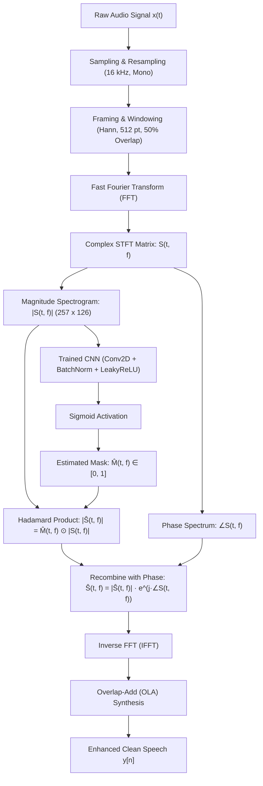

# VoxClean AI: Complete Technical & Signals/Systems Documentation

---

## 1. Executive Summary & Overview

**VoxClean AI** is an end-to-end deep learning and digital signal processing (DSP) speech enhancement system developed in MATLAB. Its primary objective is **single-channel speech background noise suppression** (speech denoising) from acoustic recordings corrupted by arbitrary environmental noise (e.g., street noise, typing, restaurant babble, domestic appliances).

Instead of operating solely in the raw time-domain (which requires enormous model parameter counts to capture harmonic dependencies) or purely via classic DSP spectral subtraction (which introduces "musical noise" artifacts), VoxClean AI adopts a **Time-Frequency (T-F) Masking paradigm**:
1. Transforms 1D discrete time-domain audio signals into 2D time-frequency representations using the **Short-Time Fourier Transform (STFT)**.
2. Extracts the **magnitude spectrogram** and decouples the **phase spectrum**.
3. Employs a **Convolutional Neural Network (CNN)** to predict an **Ideal Ratio Mask (IRM)**.
4. Multiplies the estimated mask element-wise with the noisy magnitude spectrum to suppress noise components.
5. Reconstructs the clean speech waveform via the **Inverse Short-Time Fourier Transform (iSTFT)** using the original noisy phase and the Overlap-Add (OLA) synthesis method.

---

## 2. End-to-End System Architecture



---

## 3. Core Signals & Systems (DSP) Concepts

The core engine of VoxClean AI is rooted in fundamental principles of Signals and Systems. Below is a rigorous breakdown of each mathematical concept.

### 3.1 Discrete-Time Signals & Nyquist-Shannon Sampling
Sound waves in physical space are continuous-time analog signals $x_a(t)$. To process them computationally:
- **Sampling**: Converted into discrete-time sequences $x[n] = x_a(n T_s)$, where $T_s = \frac{1}{f_s}$ is the sampling period.
- **Nyquist-Shannon Theorem**: To prevent aliasing, the sampling rate must satisfy:
  $$f_s \ge 2 f_{max}$$
- **Project Standardization**: Audio is resampled to **$f_s = 16\text{ kHz}$**. 
  - Nyquist frequency = $8\text{ kHz}$.
  - The human vocal tract produces intelligible speech frequencies predominantly between $80\text{ Hz}$ and $7.5\text{ kHz}$ (formants $F_1, F_2, F_3$). A $16\text{ kHz}$ sampling rate retains 100% of speech intelligibility and phonetic details while significantly reducing memory and compute load compared to $44.1\text{ kHz}$ or $48\text{ kHz}$.

---

### 3.2 Additive Acoustic Noise Model
In real-world environments, the observed noisy microphone signal $y[n]$ is modeled as:
$$y[n] = s[n] + d[n]$$
where:
- $s[n]$ is the clean target speech signal.
- $d[n]$ is the additive uncorrelated environmental background noise (stationary or non-stationary).

---

### 3.3 Signal-to-Noise Ratio (SNR) & Synthetic Data Mixing
To train the supervised model, artificial noisy-clean pairs are synthesized across diverse signal-to-noise ratios (SNR).
The instantaneous discrete power of a signal $x[n]$ with $N$ samples is defined by its mean squared amplitude:
$$P_x = \frac{1}{N} \sum_{n=0}^{N-1} |x[n]|^2$$

The **Signal-to-Noise Ratio (SNR)** expressed in decibels ($\text{dB}$) is:
$$\text{SNR}_{\text{dB}} = 10 \log_{10}\left( \frac{P_s}{P_d} \right)$$

To achieve a target $\text{SNR}_{\text{target}}$ during training (implemented in `src/mixAudioWithSNR.m`):
1. Compute clean speech power $P_s = \frac{1}{N}\sum s[n]^2$ and raw noise power $P_d = \frac{1}{N}\sum d[n]^2$.
2. Calculate the required noise power:
   $$P_{d,\text{target}} = \frac{P_s}{10^{\frac{\text{SNR}_{\text{target}}}{10}}}$$
3. Compute the scaling factor $\alpha$:
   $$\alpha = \sqrt{\frac{P_{d,\text{target}}}{P_d}}$$
4. Generate the mixed signal:
   $$y[n] = s[n] + \alpha \cdot d[n]$$
5. Normalize to prevent numeric clipping: if $\max |y[n]| > 0.99$, apply peak normalization scaling factor.

---

### 3.4 Short-Time Fourier Transform (STFT)
Speech is an intrinsically **quasi-stationary / non-stationary signal**: its frequency distribution changes rapidly as phonemes and vocal cords modulate (vowels, fricatives, plosives). A standard Discrete Fourier Transform (DFT) over the entire audio would blur temporal information.

To capture both time and frequency simultaneously, we apply the **STFT**:
$$X(m, k) = \sum_{n=-\infty}^{\infty} x[n] \cdot w[n - mR] \cdot e^{-j \frac{2\pi}{N_{FFT}} k n}$$
where:
- $m$ is the time frame index.
- $k$ is the discrete frequency bin index ($k = 0, 1, \dots, N_{FFT}/2$).
- $w[n]$ is the analysis window function of length $L$.
- $R$ is the hop size (step size in samples between consecutive frames).
- $N_{FFT}$ is the number of points in the FFT.

#### Parameters in VoxClean AI:
| Parameter | Value | DSP Significance |
|---|---|---|
| Sampling Rate ($f_s$) | $16,000\text{ Hz}$ | Nyquist limit = $8,000\text{ Hz}$ |
| Window Length ($L$) | $512\text{ samples}$ | Duration $\tau = \frac{512}{16000} = 32\text{ ms}$ (ideal quasi-stationary speech window) |
| Hop Length ($R$) | $256\text{ samples}$ | $50\%$ overlap; temporal hop step = $16\text{ ms}$ |
| FFT Points ($N_{FFT}$) | $512$ | One-sided spectrum yields $\frac{512}{2} + 1 = 257$ frequency bins |
| Frequency Resolution ($\Delta f$) | $\frac{f_s}{N_{FFT}} = 31.25\text{ Hz}$ | Narrow enough to distinguish fundamental pitch and harmonics |
| Temporal Frames ($T$) | $126\text{ frames}$ | Corresponds to exactly $2.0$ seconds of audio: $(126 - 1) \times 256 + 512 \approx 32,512 \approx 2\text{ s}$ |

---

### 3.5 Windowing & Spectral Leakage (The Hann Window)
Truncating a continuous signal abruptly using a rectangular window corresponds to convolution in the frequency domain with a $\text{sinc}$ function, producing high-energy side lobes that cause **spectral leakage** (spurious energy spilling across adjacent frequency bins).

VoxClean AI employs the **periodic Hann window**:
$$w[n] = 0.5 \left( 1 - \cos\left( \frac{2\pi n}{N} \right) \right), \quad 0 \le n < N$$
- **Side Lobe Attenuation**: The Hann window suppresses the first side lobe to $-31.5\text{ dB}$ (compared to $-13\text{ dB}$ for a rectangular window), virtually eliminating spectral leakage across frequency bins.
- **Constant Overlap-Add (COLA) Property**: With a 50% hop length ($R = N/2$), the sum of shifted Hann windows satisfies:
  $$\sum_{m} w[n - mR] = \text{Constant}$$
  ensuring lossless, distortion-free reconstruction during synthesis.

---

### 3.6 Magnitude vs. Phase Decomposition
The STFT output is complex-valued:
$$X(m, k) = |X(m, k)| \cdot e^{j \angle X(m, k)}$$
- **Magnitude $|X(m, k)|$**: Represents spectral energy/envelope (formants, pitch harmonics, energy density).
- **Phase $\angle X(m, k) = \arctan\left(\frac{\text{Im}(X)}{\text{Re}(X)}\right)$**: Represents fine temporal structure and wave alignment.

**Psychoacoustic Fact & Phase Assumption**:
In human perception, the auditory system is largely "phase-deaf" to modest phase perturbations, while extremely sensitive to spectral magnitude changes. Consequently:
- The deep learning model predicts masks strictly for the **magnitude spectrogram**.
- The noisy phase $\angle Y(m, k)$ is preserved and reused directly during reconstruction, avoiding unstable phase estimation algorithms.

---

### 3.7 The Ideal Ratio Mask (IRM)
Instead of predicting clean speech magnitudes directly (which can exhibit arbitrary unbounded ranges across speakers and recording gains), the network learns a bounded **transfer mask**:
$$\text{IRM}(m, k) = \frac{|S(m, k)|}{|Y(m, k)| + \epsilon}$$
- Bounded strictly between $[0.0, 1.0]$.
- **Physical Meaning**:
  - $\text{IRM}(m, k) \approx 1.0 \implies$ The T-F bin is dominated by clean speech; retain full energy.
  - $\text{IRM}(m, k) \approx 0.0 \implies$ The T-F bin is dominated by noise; attenuate completely.
  - $\text{IRM}(m, k) \in (0, 1) \implies$ Shared energy bin; softly attenuated.
- $\epsilon = 10^{-8}$ prevents division by zero in silent frames.

---

### 3.8 Inverse Short-Time Fourier Transform (iSTFT) & Waveform Synthesis
After the neural network estimates the mask $\widehat{M}(m, k)$, the enhanced complex spectrum is constructed:
$$\widehat{S}(m, k) = \left( \widehat{M}(m, k) \odot |Y(m, k)| \right) \cdot e^{j \angle Y(m, k)}$$

The time-domain signal is synthesized via **iSTFT with Overlap-Add (OLA)**:
1. Apply the Inverse Discrete Fourier Transform (IDFT) to each frame:
   $$\hat{s}_m[n] = \frac{1}{N_{FFT}} \sum_{k=0}^{N_{FFT}-1} \widehat{S}(m, k) \cdot e^{j \frac{2\pi}{N_{FFT}} k n}$$
2. Multiply by the synthesis window $w[n]$:
   $$\tilde{s}_m[n] = \hat{s}_m[n] \cdot w[n]$$
3. Overlap and add successive frames shifted by hop size $R$:
   $$\hat{s}[n] = \frac{\sum_m \tilde{s}_m[n - mR]}{\sum_m w^2[n - mR]}$$
4. Take the real part: $\text{enhancedAudio} = \text{Re}(\hat{s}[n])$.

---

## 4. Deep Learning Network Architecture

The network acts as a **2D Convolutional Regression Filter** that maps a noisy spectrogram into an estimated IRM.

```
Input: [257 Frequency Bins × 126 Time Frames × 1 Channel]
  │
  ▼
[Conv2D (3x3, 16 filters, Padding 'same')] ──> [Batch Normalization] ──> [Leaky ReLU (α=0.2)]
  │
  ▼
[Conv2D (3x3, 32 filters, Padding 'same')] ──> [Batch Normalization] ──> [Leaky ReLU (α=0.2)]
  │
  ▼
[Conv2D (3x3, 16 filters, Padding 'same')] ──> [Batch Normalization] ──> [Leaky ReLU (α=0.2)]
  │
  ▼
[Conv2D (3x3, 1 filter, Padding 'same')]
  │
  ▼
[Sigmoid Activation Function]  ───> Enforces output in range [0.0, 1.0]
  │
  ▼
Output: [257 × 126 × 1] Predicted Ideal Ratio Mask
```

### Key Neural Network Components:
1. **2D Spatial Convolutions**:
   - The receptive field convolves across both frequency and time bins simultaneously.
   - Learns spectral continuity along time (speech vowel sustains) and harmonic spacing along frequency (pitch comb structure).
2. **Batch Normalization**:
   - Accelerates convergence and stabilizes learning against amplitude variations across speakers.
3. **Leaky ReLU ($\alpha = 0.2$)**:
   - Prevents "dying ReLU" neurons when gradients are small in silence/low-energy regions.
4. **Sigmoid Layer**:
   $$S(z) = \frac{1}{1 + e^{-z}}$$
   - Guarantees the output mask mathematically remains in the interval $[0, 1]$, perfectly matching the definition of the Ideal Ratio Mask.
5. **Loss Function**:
   - **Mean Squared Error (MSE) / Root Mean Squared Error (RMSE)** between true mask $M$ and predicted mask $\widehat{M}$:
     $$\mathcal{L}_{MSE} = \frac{1}{B \cdot F \cdot T} \sum_{b=1}^{B} \sum_{f=1}^{F} \sum_{t=1}^{T} \left| M(t, f) - \widehat{M}(t, f) \right|^2$$
6. **Optimization**:
   - **Adam Optimizer**: Initial learning rate $\eta = 10^{-3}$, adaptive moments for fast convergence.

---

## 5. Codebase Implementation Breakdown

| File | Purpose | DSP / ML Role |
|---|---|---|
| [`src/loadAudio.m`](file:///c:/Users/Anup/Desktop/VoxClean_AI/src/loadAudio.m) | Audio ingestion & formatting | Reads WAV, mixes stereo channels to mono ($\frac{L+R}{2}$), resamples to $16\text{ kHz}$. |
| [`src/mixAudioWithSNR.m`](file:///c:/Users/Anup/Desktop/VoxClean_AI/src/mixAudioWithSNR.m) | Realistic noise mixing | Calculates signal/noise RMS powers, tiles noise if shorter, scales noise to target SNR, prevents audio clipping. |
| [`src/computeSTFT.m`](file:///c:/Users/Anup/Desktop/VoxClean_AI/src/computeSTFT.m) | Time $\to$ Frequency transformation | Applies 512-pt Hann window, $50\%$ overlap, returns 257 one-sided frequency bins with magnitude and phase. |
| [`src/computeIdealRatioMask.m`](file:///c:/Users/Anup/Desktop/VoxClean_AI/src/computeIdealRatioMask.m) | Ground truth target creation | Computes $|S| / (|Y| + \epsilon)$, clips values to $[0, 1]$. |
| [`src/createDataset.m`](file:///c:/Users/Anup/Desktop/VoxClean_AI/src/createDataset.m) | Pairing clean & noise files | Randomly pairs clean speech files with random noise files at random SNRs ($-5\text{ dB}$ to $+15\text{ dB}$). |
| [`src/trainModel.m`](file:///c:/Users/Anup/Desktop/VoxClean_AI/src/trainModel.m) | Pipeline training script | Builds CNN architecture, extracts STFTs, constructs 4D tensors `[257, 126, 1, N]`, calls `trainNetwork`, saves `models/trainedModel.mat`. |
| [`src/enhanceSpeech.m`](file:///c:/Users/Anup/Desktop/VoxClean_AI/src/enhanceSpeech.m) | Audio inference engine | Loads trained `.mat`, extracts STFT, predicts mask, applies mask to magnitude, combines with noisy phase, executes iSTFT, writes clean WAV. |
| [`generateTestAudio.m`](file:///c:/Users/Anup/Desktop/VoxClean_AI/generateTestAudio.m) | Synthetic test file creator | Quickly blends sample speech and noise at $5\text{ dB}$ SNR into `messy_test_file.wav` for immediate GUI testing. |
| [`app/VoxCleanApp.m`](file:///c:/Users/Anup/Desktop/VoxClean_AI/app/VoxCleanApp.m) | User Interface | Built with MATLAB App Designer (`uifigure`). Lets users load noisy audio, visualize spectrograms, trigger AI enhancement, and play A/B comparisons. |

---

## 6. Performance Evaluation Metrics

To quantitatively assess enhancement quality, the following metrics are used:

1. **SNR Improvement ($\Delta\text{SNR}$)**:
   $$\Delta\text{SNR} = \text{SNR}_{\text{output}} - \text{SNR}_{\text{input}}$$
   Measures how many decibels of background noise power were suppressed relative to target speech energy.
2. **Log-Spectral Distance (LSD)**:
   $$\text{LSD} = \frac{1}{T} \sum_{t=1}^{T} \sqrt{\frac{1}{F} \sum_{f=1}^{F} \left( 10 \log_{10} \frac{|S(t,f)|^2}{|\widehat{S}(t,f)|^2} \right)^2}$$
   Measures spectral envelope distortion introduced by the enhancement filter.
3. **Perceptual Evaluation of Speech Quality (PESQ - ITU-T P.862)**:
   Standard perceptual metric scoring audio quality from $1.0$ (bad) to $4.5$ (crystal clear).
4. **Short-Time Objective Intelligibility (STOI)**:
   Evaluates speech intelligibility based on correlation of short-time temporal envelopes, scoring between $0.0$ and $1.0$.

---

## 7. Summary Workflow for Demonstrating the Project

```matlab
% 1. Navigate to project root in MATLAB
cd 'C:\Users\Anup\Desktop\VoxClean_AI';

% 2. Add dependencies to path
addpath('src');
addpath('app');

% 3. Train the model (if not already trained)
trainModel(10, 16, 1e-3);

% 4. Generate a test noisy file
generateTestAudio();

% 5. Launch the GUI
VoxCleanApp;
```
